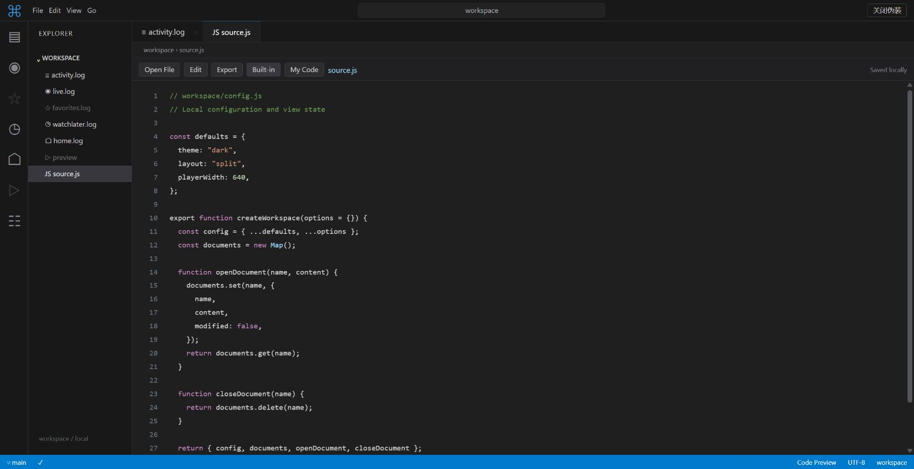

# Bili Workspace

将 B 站的动态、普通视频、直播、收藏夹、稍后再看和主站推荐显示为 VS Code 风格工作界面的 Tampermonkey 用户脚本。

当前代码版本：**0.7.0**。2026-11-18，使用者确认此前待复验的实际使用项目均已验证通过，包括真实浏览器缓存往返、标签单次关闭、返回动态的位置保留及手动选择本地代码文件的完整导入流程。

[安装用户脚本](https://raw.githubusercontent.com/Feng-Li-123/B-vscode-/main/bili-workspace.user.js) · [查看源码](https://github.com/Feng-Li-123/B-vscode-/blob/main/bili-workspace.user.js) · [反馈问题](https://github.com/Feng-Li-123/B-vscode-/issues)

## 安装

1. 安装 Tampermonkey。
2. 点击上方“安装用户脚本”，按脚本管理器提示安装；也可以打开本仓库的 `bili-workspace.user.js`，选择 **Raw**，或创建新用户脚本，将该文件的全部文本粘贴进去并保存。
3. 打开支持的 B 站页面，在 Tampermonkey 菜单中选择“开启工作界面（刷新当前页）”。
4. 初次安装默认关闭。之后可以用右上角“关闭伪装”或脚本菜单恢复原页面。

公开版本直接安装完整的单文件脚本，**不需要本地加载器、固定磁盘路径、开发服务器、Node.js、Python 或 Bilibili Evolved**。如果原先使用本地开发加载器，安装完整脚本时应替换原有脚本，避免同一页面同时运行两个副本。

公开脚本已设置本仓库的 `@updateURL` 与 `@downloadURL`，供脚本管理器按其更新设置检查后续版本。更新需提高脚本 `@version`；具体检查时机由脚本管理器设置决定。本地开发加载器继续用于本机开发，两种安装方式选择一种。

## 支持页面与功能

- 动态首页：保留原生动态、图片和评论。
- 普通视频：播放器固定在左侧，右侧评论独立滚动，保留原生进度条和弹幕开关；支持上下布局回退及 640／440 px 宽度上限。
- 数字房间号直播间：左侧原生播放器，右侧深色弹幕面板。
- 直播关注列表：使用原站“我的关注”列表，不依赖无限加载插件。
- 收藏夹：保留原生收藏目录、视频、搜索、排序和分页。
- 稍后再看：保留原生列表、搜索及进度筛选。
- 主站推荐：紧凑的视频列表。
- 工作区顶部标签：在同一个 Chrome 标签页内切换；每个工作区独立维护打开项。
- 代码页：显示内置源码，或者导入／粘贴自己的文本；支持编辑、本地草稿、预览和导出。

左侧顺序为 `activity.log`、`live.log`、`favorites.log`、`watchlater.log`、`home.log`。

暂不适配搜索、热门／分区、番剧、动态详情、图文详情、收藏夹以外的个人空间和直播门户首页。“播放全部”进入的独立列表播放器继续交给原站。

## 代码页

该图使用本地合成的配置代码，未包含真实账号、收藏列表或用户源文件。

| 操作 | 用途 |
| --- | --- |
| Open File | 选择一个 UTF-8 文本／代码文件，最大 256 KB |
| Edit | 修改文本，也可以全选并粘贴自己的代码 |
| Preview | 查看行号与基础语法颜色 |
| Export | 将当前完整文本下载为文件 |
| Built-in | 显示内置脚本源码，同时保留自定义草稿 |
| My Code | 返回保存的自定义代码 |

编辑约 400 毫秒后自动保存本地草稿，Ctrl+S 也能保存。编辑操作修改内存中的文本和本脚本的草稿，**没有回写所选磁盘源文件的操作**。需要保存为磁盘文件时使用 Export，并由浏览器正常处理下载。

展示和导入的代码不执行；预览提供基础颜色，编辑模式使用普通文本区域。没有代码编译、运行、语言服务器或完整工程管理功能。

## 依赖与数据

运行依赖为浏览器、Tampermonkey、B 站原生页面及其页面结构。

- 动态、收藏夹和待看队列等内容由 B 站原生页面加载，需要相应登录状态。
- 脚本通过原生导航链接识别当前用户的收藏夹，不在源码硬编码用户号或收藏夹号。
- 开关、布局、自定义代码草稿、页面标签及返回动态的位置等设置由脚本管理器存储，运行后产生的数据不写入这个 `.user.js` 文件。
- `GM_getTab` 与 `GM_saveTab` 用于当前 Chrome 标签页的状态；`GM_getValue`、`GM_setValue` 用于脚本自己的设置；`GM_registerMenuCommand` 提供开关。
- 主脚本没有额外的 `fetch`、`XMLHttpRequest` 或账号接口请求，也没有把自定义代码发送到服务器的逻辑。站点自身仍按原方式加载内容、记录播放及处理原生操作。
- Bilibili Evolved 等其他插件是可选项。当前共存检查来自有限环境，不能据此保证所有插件组合都兼容。
- 默认关闭分支在访问页面 DOM、启动观察器和定时器之前退出。

B 站更新页面结构可能影响外观和布局；其他插件重构原生节点也可能造成兼容问题。

## 验证范围

完成的检查：

- JavaScript 语法。
- 9 项工作区标签、关闭、升级及刷新检查。
- 保持旧同步存储快照的多文档缓存恢复检查。
- 6 组代码编辑、文件读取处理、草稿及完整导出内容检查。
- 8 个关闭状态场景、11 个范围外页面场景。
- 真实动态→收藏的一次跳转标签数量、独立工作区隔离、原生收藏内容与代码页往返。

实际使用补充验收（使用者于 2026-11-18 确认通过）：

- 新接口授权安装后的真实 Tampermonkey 连续缓存往返、标签单次关闭及动态位置保留。
- 系统文件选择完成后的端到端代码导入体验。

上述补充验收来自使用者的实际使用确认。其他浏览器、其他脚本管理器、所有插件组合及全部媒体行为没有全面覆盖；已通过的当前需求验收不代表这些组合均已验证。

## 发布目录

本目录仅包含主脚本、通用说明、许可证、变更记录和合成的代码预览图。不包含本机加载路径、个人页面截图、测试页面快照、账号设置或脚本管理器导出数据。

若后续从自己的工作目录添加文件，请避免将个人截图、真实页面快照或包含设置值的脚本管理器备份一起提交。

## 参考与许可

当前源码沿用 MIT 许可，完整文本见 `LICENSE`。

界面与适配思路参考：

- [czm15053/linuxdo-idea-ui](https://github.com/czm15053/linuxdo-idea-ui)：办公界面外壳、主题作用域和原生外观恢复思路。
- [the1812/Bilibili-Evolved](https://github.com/the1812/Bilibili-Evolved)：B 站原生播放器与控件结构的适配思路。

此目录不打包上述项目的脚本或其运行组件。B 站页面与内容仍来自原站；本项目不是 Bilibili 或 Visual Studio Code 的官方产品。
